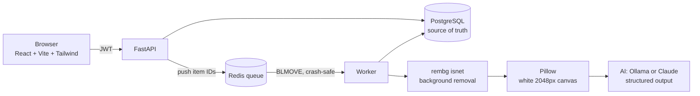

# AI Catalog Assistant

**Upload a batch of product photos → get clean white-background images and AI-written catalog listings, ready to review and export.**

Online sellers spend hours on every new product line: removing photo backgrounds, then writing a title, description, category and tags for each item. AI Catalog Assistant does both in one pass, for up to 50 photos at a time, and keeps a human in control of the final result.

> **Status:** v1 complete (November 2026) · runs locally · 89 backend tests · not deployed yet


---

## What it does

1. **Log in** and drag-and-drop up to 50 product photos (JPEG/PNG). Unusable files are skipped with a reason; the rest upload.
2. For every photo, a background worker:
   - removes the background and centres the product on a **2048 px white canvas** (rotation, transparency and colour-mode fixes included)
   - asks an **AI vision model** for a validated listing: **title, description, category** (women / men / kids / baby), **colours, tags**
3. Watch **live progress** per photo: queued → processing → done / needs review / failed.
4. **Review and edit** anything the AI got wrong. Edited fields are protected: the AI never overwrites them, even on retry.
5. **Retry** a failed photo, then **download** the catalog as CSV and the clean images as a zip (file names match the CSV rows).

**The AI is pluggable.** One setting (`AI_PROVIDER`) switches between a **free local model** (Ollama, `qwen2.5vl:7b`) and **Claude** (paid API). Both return the same validated JSON schema.

## Built for real users, not just the happy path

| Real situation | How it's handled |
|---|---|
| Another user changes the ID in the URL | Every query is owner-scoped → **404**, never someone else's data |
| A PDF renamed to `.jpg`, a half-downloaded photo, an iPhone HEIC | File **contents** are checked, not the name; that file is skipped with a clear reason, **the rest of the batch continues** |
| An iPhone JPEG with embedded HDR/depth data (MPO) | Accepted as a normal JPEG (found by testing with a real phone photo) |
| A double-clicked Upload or Retry button | **Idempotency key** / atomic compare-and-set → exactly one batch, one re-run |
| A sideways phone photo, a transparent PNG | EXIF rotation applied; transparency placed on white (not black) |
| The AI is busy, rate-limited or offline | Claude: retried with backoff by the SDK. Still failing (or Ollama down) → **failed**, with a "Click Retry" message; the clean image is kept |
| The AI contradicts itself or invents details | Pydantic validates the JSON; `tidy()` enforces the rules in code (e.g. non-clothing → no category) |
| A photo that isn't clothing | **Needs review**, with no invented product description |
| The worker crashes mid-photo | Crash-safe Redis hand-off (`BLMOVE` + acknowledge after commit) + recovery on restart: no photo is lost |
| Redis was down during an upload | The upload still succeeds; a **sweep** re-queues items stuck in `queued` |
| The user edits while the worker is still running | Edits are refused until processing finishes (prevents a lost update) |
| AI text starting with `=` in the CSV | **CSV formula injection** neutralised; commas, quotes and accents survive (UTF-8 BOM for Excel) |
| A title like `../../etc/passwd` in the zip | Zip entry names are slugged: **zip slip** is impossible |

Each row is covered by named scenario tests (e.g. `test_user_cannot_see_another_users_batch`, `test_double_click_upload_creates_one_batch`, `test_csv_formula_injection_is_neutralised`). Tests use a fake AI client, a fake background remover and generated test images, so the suite is free, fast and can simulate failures on demand.

## Architecture



- The API only **validates, saves and enqueues** (about 1 s per upload). The slow work (3–30 s per photo) runs in the worker, so uploads never time out.
- **Progress is computed** (`COUNT … GROUP BY status`), never stored, so it can't drift.
- The browser **polls every 2 s** only while photos are in progress.
- The background-removal model was **chosen by experiment**: 3 models on the same real photos, with saved outputs and timings ([`experiments/2026-11-14_rembg_models/results.md`](experiments/2026-11-14_rembg_models/results.md)).

## Tech stack

| Layer | Tools |
|---|---|
| Backend | Python 3.14, FastAPI, Pydantic v2, SQLAlchemy 2, Alembic |
| Data | PostgreSQL 16, Redis 7 (job queue) |
| AI | Ollama (`qwen2.5vl:7b`, local) or Claude API, via structured outputs · rembg (`isnet-general-use`) · Pillow |
| Frontend | React 19, TypeScript, Vite, Tailwind CSS |
| Auth | JWT (OAuth2 password flow), bcrypt |
| Testing | pytest (89 scenario tests), FastAPI TestClient, `httpx.MockTransport` |
| Infra | Docker Compose |

## Running locally

**Prerequisites:** Python 3.14, Node 20.19+, Docker, and [Ollama](https://ollama.com) (`brew install ollama`).

```bash
git clone https://github.com/madBit10/catalog-assistant.git && cd catalog-assistant

# Backend
python3 -m venv .venv && source .venv/bin/activate
pip install -r requirements.txt
cp .env.example .env              # then set JWT_SECRET (and passwords)
docker compose up -d              # PostgreSQL + Redis
alembic upgrade head              # create the tables

# Local AI (free; ~6 GB download, once)
brew services start ollama
ollama pull qwen2.5vl:7b

# Frontend
cd frontend && npm install && cd ..
```

Then run three processes in separate terminals:

```bash
uvicorn app.main:app --reload             # 1 · API → http://127.0.0.1:8000/docs
python -m app.worker                      # 2 · worker: processes uploaded photos
cd frontend && npm run dev                # 3 · app → http://localhost:5173
```

**Using Claude instead of Ollama:** set `AI_PROVIDER=claude` and `ANTHROPIC_API_KEY=…` in `.env`, then restart the worker.

The first photo downloads the background-removal model (~180 MB) once.

## Tests

```bash
pytest                                    # 89 tests, ~20 s; uses a separate catalog_test database
cd frontend && npm run build              # type-check + production build
```

| Area | Tests | Examples |
|---|---|---|
| Accounts | 12 | duplicate email (any capitalisation), 74-byte password, expired/forged token |
| Ownership | 3 | another user's batch and item → not found |
| Uploads | 15 | renamed PDF, double click, two clicks at once, weird file names, Redis down, upload order |
| Image checks | 10 | empty, HEIC, GIF, truncated, too small, 54 MP, iPhone MPO |
| Worker | 17 | crash recovery, retry once then fail, duplicate delivery, sweep, user edits survive a retry |
| AI layer | 11 | `tidy()` rules, Ollama down / garbage answer, Claude 429 / wrong key / refusal |
| Review | 13 | mass assignment blocked, edit while processing → 409, double-click retry → one run |
| Export | 8 | commas/quotes/accents, formula injection, matching CSV/zip names, zip slip |

## Known limitations (honest list)

- **One product per photo:** a photo of several items becomes one listing.
- **Listing quality:** the local model sometimes writes lowercase titles, misses printed text or adds details it can't see (logged in [`experiments/ai_observations.md`](experiments/ai_observations.md)). There's no formal accuracy evaluation yet.
- **Speed:** the local model takes ~20–30 s per photo on an M4 MacBook (Claude is faster).
- **Not production-hardened:** no login rate limiting, the token is kept in `localStorage`, files are on local disk (not S3), and there's no deployment or CI yet.

## Design documents

- [`docs/SYSTEM_DESIGN.md`](docs/SYSTEM_DESIGN.md): requirements, back-of-envelope numbers, data model, decisions and trade-offs, API, test plan
- [`docs/FLOW.md`](docs/FLOW.md): how the code connects, flow by flow
- [`experiments/`](experiments/): the background-removal model comparison and the AI observations log

## Next steps

GitHub Actions CI · deployment · login rate limiting · formal evaluation (Ollama vs Claude on labelled photos) · S3 storage · multi-product photo detection · store integration (Shopify CSV/API)
