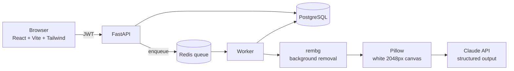

# AI Catalog Assistant

> 🚧 **Work in progress**: design complete, build underway. Target: **November 1, 2026**.

**Upload a batch of product photos → get clean white-background images and AI-written catalog listings, ready to review and export.**

Online sellers spend hours on every new product line: removing photo backgrounds, then writing a title, description, category and tags for each item. AI Catalog Assistant does both in one pass, for dozens of photos at a time, and keeps a human in control of the final result.

---

## What it does

1. **Log in** and drag-and-drop a batch of up to 50 product photos.
2. For every photo, a background worker:
   - removes the background and centres the product on a clean **2048 px white canvas**
   - sends the image to **Claude** and gets back validated catalog data: **title, description, category** (women / men / kids / baby), **colours, tags**
3. Watch **live progress** per photo: queued → processing → done / needs review / failed.
4. **Review and edit** anything the AI got wrong. Your edits are never overwritten.
5. **Export** the catalog as CSV and download the clean images as a zip.

## Built for real users, not just the happy path

The system is designed and tested around what real users actually do:

| Real situation | How it's handled |
|---|---|
| Another user changes the ID in the URL | Every query is owner-scoped → **404**, never someone else's data |
| A PDF renamed to `.jpg` | File contents are checked, not the name; that file fails, **the rest of the batch continues** |
| A double-clicked Upload button | **Idempotency key** → exactly one batch |
| The AI service rate-limits | **Retried with backoff**, invisible to the user |
| A photo that isn't clothing | Flagged **"needs review"** instead of inventing a product description |
| The worker crashes mid-batch | **Crash-safe queue**: no photo is lost |
| An AI description starting with `=` | **CSV formula injection** is neutralised before export |

Each row maps to a named scenario test, run against a folder of real-world bad files with a fake AI client, so the tests are free to run and can simulate failures on demand.

## Architecture



The API only **saves and enqueues** (about 1 second per upload); the worker does the slow work in the background, so uploads never time out.

## Tech stack

| Layer | Tools |
|---|---|
| Backend | Python, FastAPI, Pydantic, SQLAlchemy, Alembic |
| Data | PostgreSQL, Redis (job queue) |
| AI | Claude API (vision + structured outputs), rembg (background removal), Pillow |
| Frontend | React, Vite, Tailwind CSS |
| Auth | JWT (OAuth2 password flow), bcrypt |
| Quality | pytest scenario tests, GitHub Actions CI |
| Infra | Docker Compose |

## Roadmap

- [x] System design: requirements, data model, decisions, API, test plan
- [x] Project setup: virtual environment, Docker Compose (PostgreSQL + Redis)
- [x] Database models + migrations
- [ ] Register / login / JWT + owner-scoped access
- [ ] Upload endpoint: file validation, idempotency, safe file storage
- [ ] Image cleanup: background removal + white canvas
- [ ] Claude structured-output call
- [ ] Redis queue + worker + retry policy
- [ ] Real-user scenario tests
- [ ] GitHub Actions CI (tests on every push)
- [ ] CSV + zip export
- [ ] React frontend
- [ ] Evaluation: Claude Haiku 5.5 vs Claude Opus 5.5 on 30 labelled photos
- [ ] Deployment + demo

## Design documents

- [`docs/SYSTEM_DESIGN.md`](docs/SYSTEM_DESIGN.md): requirements, back-of-envelope numbers, data model, decisions and trade-offs, API, real-user test plan
- [`docs/FLOW.md`](docs/FLOW.md): how the code connects, flow by flow

## Running locally (current state)

Only the infrastructure exists so far:

```bash
git clone <this repo> && cd catalog-assistant
python3 -m venv .venv && source .venv/bin/activate
pip install -r requirements.txt
cp .env.example .env        # then fill in your values
docker compose up -d        # PostgreSQL + Redis
alembic upgrade head        # create the database tables
```

Full setup instructions will be added as the application is built.
