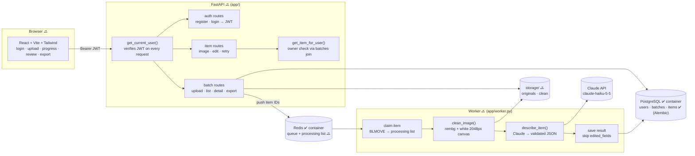
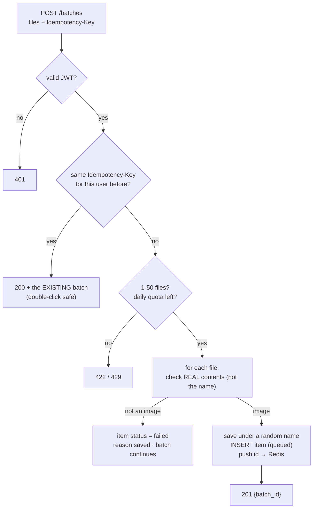
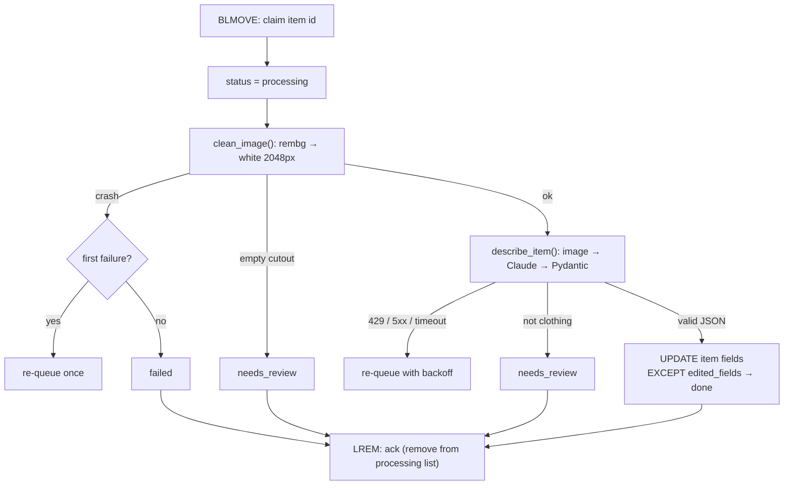
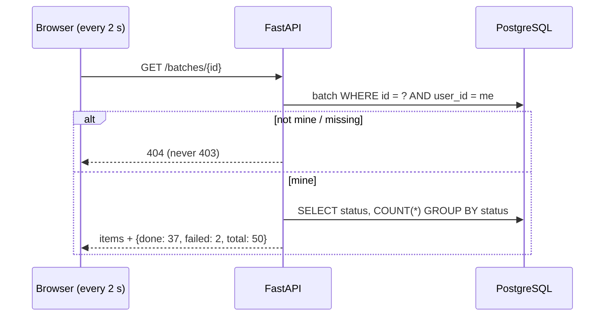

# AI Catalog Assistant: How the Code Connects

Read this before reading the code. It answers:
1. **What is connected to what?** (system map)
2. **What happens when I run or call X?** (one flow per endpoint / function)
3. **Where does data live, and who writes or reads it?** (data map)

Status: ✅ **exists** · 🔜 **planned** (designed in `SYSTEM_DESIGN.md`, not written yet).
Updated with every code change. If a diagram and the code disagree, the code wins and this file gets fixed.

*Last updated: 2026-10-29: config, DB connection, `Base`, all three models and the first Alembic migration exist; tables are live in PostgreSQL. Auth next.*

---

## 1. System map



**Read it left to right:** the API only **saves and enqueues** (fast); the worker does the **slow work** (seconds per photo). They never call each other directly; they meet through Redis and PostgreSQL.

---

## 2. Flows: "what happens if I call this?" (all 🔜)

### 2.1 `POST /batches`: uploading photos


### 2.2 The worker: one photo


### 2.3 `GET /batches/{id}`: the progress bar


---

## 2.4 Startup: how settings and the database connection load ✅
```mermaid
flowchart LR
    ENV[".env"] -->|read + type-checked| CFG["app/core/config.py<br/>settings = Settings()<br/>(app refuses to start if a value is missing/wrong)"]
    CFG -->|settings.database_url| DBF["app/db/database.py<br/>engine (pool_pre_ping) · SessionLocal · get_db()"]
    BASE["app/db/base.py<br/>class Base(DeclarativeBase)"] --> MOD["app/db/models.py ✅<br/>User · Batch · Item"]
    DBF -->|get_db() per request| ROUTES["API routes 🔜"]
    MOD -.->|Base.metadata| ALE["alembic/env.py ✅<br/>imports models · URL from settings"]
```
`base.py` imports nothing from the app, so models never open a DB connection just by being imported.

## 3. Data map: who writes, who reads

| Location | Written by | Read by | In git? |
|---|---|---|---|
| `.env` | you, by hand | `app/core/config.py` ✅ (pydantic-settings validates it at startup), docker-compose ✅ | ❌ never |
| `.env.example` | Claude (placeholders only) ✅ | new developers, as a template | ✅ |
| `README.md` | Claude ✅, updated as features land | GitHub visitors, recruiters | ✅ |
| `requirements.txt` | updated whenever a package is added ✅ | `pip install -r`, CI, deployment | ✅ |
| PostgreSQL `users` | `POST /auth/register` 🔜 | login, `get_current_user` 🔜 | ❌ |
| PostgreSQL `batches` | `POST /batches` 🔜 | batch routes, quota check 🔜 | ❌ |
| PostgreSQL `items` | `POST /batches`, worker, `PATCH /items` 🔜 | everything 🔜 | ❌ |
| Redis queue | `POST /batches`, `/retry` 🔜 | worker 🔜 | ❌ |
| `storage/originals/` | `POST /batches` 🔜 | worker 🔜, image route 🔜 | ❌ |
| `storage/clean/` | worker 🔜 | image route, zip export 🔜 | ❌ |
| `alembic/versions/*.py` | `alembic revision --autogenerate`, then reviewed by hand ✅ | `alembic upgrade head` → creates/changes tables | ✅ |
| `docs/SYSTEM_DESIGN.md` | design sessions ✅ | you, interviewers | ✅ |
| `docs/FLOW.md` | updated with every code change ✅ | you, before reading code | ✅ |
| `docs/CHANGES_MADE.md` | every change Claude makes ✅ | you | your choice |

---

## 4. Rule for keeping this file honest
When code is added or changed, update this file **in the same step**: new endpoint or function → a flow in §2; new file or storage location → a row in §3; planned part now written → flip 🔜 to ✅ in §1.
