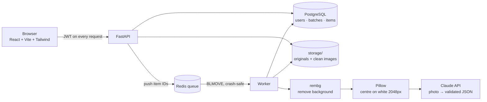
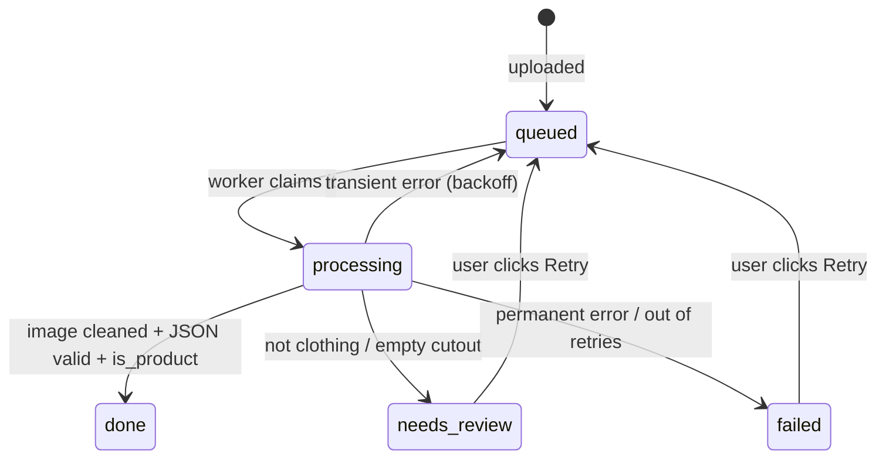
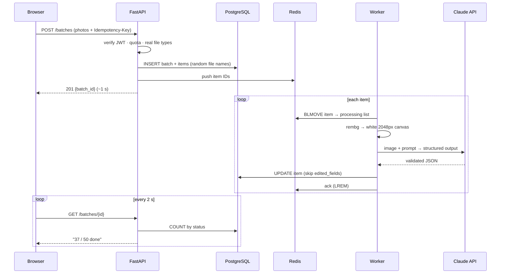

# AI Catalog Assistant: System Design

> A store admin logs in, drops in a batch of product photos, and gets back, for every photo, a **clean white-background image** and **AI-written catalog data** (title, description, category, colours, tags) to review, edit and export.

*Design session: 2026-10-24 · Status: design locked, build starting · Target: **Sunday 2026-11-01** · Model: `claude-haiku-5-5` (compared against `claude-opus-5-5` at the end)*

---

## 1. Requirements

### Must do (v1)
1. Users **register and log in**; everything except login requires a valid login.
2. Upload a **batch of 1–50 photos** (JPEG/PNG).
3. Each photo becomes a clean **2048 px, white-background** image.
4. Each photo gets **title, description, category** (`women` / `men` / `kids` / `baby`), **colours, tags**.
5. **Live progress** per photo: `queued → processing → done / needs_review / failed`.
6. **Edit** any AI field; **export CSV** and **download a zip** of clean images.
7. A failed photo **never stops the batch**, and can be **retried**.
8. **Many real users**: each user only ever sees their own data.

### Won't do (v1), and why
| Out of scope | Why |
|---|---|
| Pushing to a real store (Shopify, etc.) | Needs a real store account; CSV export proves the idea |
| Cloud storage (S3) | Local disk is enough for a demo → "next steps" |
| Sharing batches between users | One owner per batch keeps the security model simple |
| Virtual try-on / AI-generated models | Too risky for the timeline: unpredictable quality, 35–45 h |
| Live push updates (WebSockets) | Polling every 2 s is simpler and reliable for a progress bar |

### Back-of-envelope numbers
| Quantity | Estimate | Consequence |
|---|---|---|
| Time per photo | rembg 1–3 s + Claude call 2–5 s | A 50-photo batch takes **~3–6 min** on one worker → **must use a queue** so uploads return instantly |
| Cost per photo (Haiku 5.5, $0.10 / $0.50 per MTok) | well under 1¢ | A 50-photo batch costs a few cents |
| Cost per photo (Opus 5.5, $4 / $20 per MTok) | ~2–3¢ | Affordable for the end-of-project comparison |
| Progress polling | 100 users × 1 request / 2 s ≈ **50 queries/s**, each counting ≤50 indexed rows | Trivial for PostgreSQL → progress can be **computed**, not stored (Decision Q1) |

---

## 2. Architecture

**Why a separate worker:** processing takes minutes; doing it inside the upload request would make the browser wait and time out. The API only **saves and enqueues** (≈1 s); the worker does the slow work in the background. This is the same pattern as the Webhook Delivery Service.

---

## 3. Data model

**Rule:** every column exists because a requirement or a test needs it.

### `users`
| Column | Why |
|---|---|
| `id` UUID | Random, so IDs can't be guessed (a second defence against peeking) |
| `email` unique, stored lowercase | Login; lowercase stops `A@x.com` and `a@x.com` becoming two accounts |
| `password_hash` | Passwords are **never stored**, only a bcrypt one-way hash |
| `created_at` | Record-keeping |

### `batches`
| Column | Why |
|---|---|
| `id` UUID | |
| `user_id` → users | **The owner.** Every query filters by it |
| `idempotency_key` (unique **per user**) | A double-clicked upload returns the same batch instead of creating two |
| `created_at` | Ordering + daily quota |

### `items` (one per photo)
| Column | Why |
|---|---|
| `id` UUID, `batch_id` → batches | Owner is reached **through the batch** (Decision Q2) |
| `original_filename` | **Display only**, never used as a path |
| `stored_path`, `clean_path` | Random file names on disk |
| `status` | `queued` / `processing` / `done` / `needs_review` / `failed` |
| `attempts`, `last_error` | Retry policy + a readable error for the user |
| `title`, `description`, `category`, `colours[]`, `tags[]` | AI output (PostgreSQL arrays for lists) |
| `is_product` | AI's answer to "is this actually clothing?" → drives `needs_review` |
| `edited_fields[]` | Fields the human changed; **the AI never overwrites them** (Decision Q3) |
| `model`, `input_tokens`, `output_tokens` | Which model ran and what it cost (Haiku vs Opus comparison) |
| `created_at`, `updated_at` | Ordering, debugging |

**Indexes:** `items(batch_id)` (progress counts + owner joins) · `batches(user_id, created_at)` (my batches, quota) · unique `batches(user_id, idempotency_key)`.

### Item lifecycle

---

## 4. Decisions and trade-offs

| # | Question | Decision | Why | Rejected alternative |
|---|---|---|---|---|
| Q1 | Progress counters: store or compute? | **Compute** (`COUNT(*) … GROUP BY status`, indexed) | One **source of truth**; stored counters drift on crashes, retries and concurrent workers. Fast enough by the numbers above | Stored `done_count` columns: needs same-transaction updates + extra retry tests; premature optimisation |
| Q2 | Owner check on items | **Join through `batches`**, no `user_id` on items; one helper `get_item_for_user(item_id, user_id)` used by every endpoint | The owner is stored **once**; a duplicated `user_id` could disagree with its batch → security hole | `user_id` on items: simpler queries, but two copies of an ownership fact |
| Q3 | Protecting human edits | **Per field**: `edited_fields` list; AI skips listed fields | A seller who fixes one typo still wants the AI to refresh tags; ~3 lines of logic | One `user_edited` flag: freezes the whole item after any edit |
| Q4 | Which model? | **Claude Haiku 5.5** for the build; **compare with Opus 5.5** on the evaluation set | Near-free for development; the comparison is a measured README result | Opus only: better text, ~20–40× the cost for every dev run |
| Q5 | Batch API? | **No**, normal calls from the worker | Batch API (50% off) processes asynchronously, which breaks live progress | Batch API, kept as a scaling note |
| Q6 | Progress updates | **Polling every 2 s** | Simple, reliable | WebSockets: slicker, much more complex |

### Retry policy: transient vs permanent
*"Would trying again give a different result?"*

| Failure | Type | Action |
|---|---|---|
| Claude 429 (rate limit) / 5xx / timeout | Transient | Retry with exponential backoff |
| Not a real image (renamed PDF, corrupt file) | Permanent | Fail immediately, clear message |
| rembg crash | Unknown (memory spike vs a bad image) | **Retry once**, then fail |
| Claude output fails validation / refusal | Permanent for this input | `needs_review` with the reason |

---

## 5. API

| Method + path | Purpose | Auth | Responses |
|---|---|---|---|
| `POST /auth/register` | Create account | ❌ | 201 · 409 email taken |
| `POST /auth/login` | Verify password → JWT | ❌ | 200 token · 401 generic message |
| `POST /batches` | Upload 1–50 photos, header `Idempotency-Key` | ✅ | **201** new · **200** same batch on repeat key · 422 · 429 quota |
| `GET /batches` | My batches | ✅ | 200 |
| `GET /batches/{id}` | Batch + items + computed progress | ✅ | 200 · **404 if not mine** |
| `GET /items/{id}/image?kind=clean\|original` | Serve a photo | ✅ | 200 · 404 |
| `PATCH /items/{id}` | Edit fields → added to `edited_fields` | ✅ | 200 · 404 · 422 |
| `POST /items/{id}/retry` | Re-queue a photo | ✅ | **202** · 404 · 409 already processing |
| `GET /batches/{id}/export.csv` | Catalog CSV | ✅ | 200 |
| `GET /batches/{id}/images.zip` | Clean images | ✅ | 200 |

- **JWT:** signed token from login (`Authorization: Bearer …`), short expiry (60 min). The server verifies the signature, so no session lookup is needed.
- **404, not 403, for other users' data:** a 403 would confirm the resource exists.
- **202 for retry:** the job is accepted, not finished.

### One batch, end to end

---

## 6. Real-user problems → rules → tests

Tests are written as **real-user scenarios**, run against **real bad files** in `tests/fixtures/` (renamed PDF, corrupt JPEG, HEIC, huge 8000 px photo, non-clothing photo, transparent PNG), with a **fake Claude client** swapped in via FastAPI's `dependency_overrides`, so tests are free and can simulate 429s, refusals and bad output.

| Area | Real user situation | Rule | Test |
|---|---|---|---|
| Accounts | Changes the ID in the URL to see another shop | Owner filter → 404 | `test_user_cannot_see_another_users_batch` |
| | Wrong password | 401, generic message | `test_wrong_password_gives_generic_error` |
| | Tab left open overnight | Token expiry → 401 | `test_expired_token_is_rejected` |
| | Picks a very long passphrase (password manager) | bcrypt accepts max 72 bytes (5.x raises) → signup schema allows 8–72 bytes, clear 422 | `test_overlong_password_is_rejected_cleanly` |
| Upload | PDF renamed to `.jpg` | Check real contents; reject that file, keep the rest | `test_fake_jpg_is_rejected_but_rest_of_batch_continues` |
| | 25 MB, 8000 px phone photo | Size limit + downscale | `test_huge_photo_is_downscaled_not_crashed` |
| | iPhone HEIC photo | Clear "export as JPEG" message | `test_heic_photo_gets_clear_message` |
| | Double-clicks Upload | Idempotency key → one batch | `test_double_click_upload_creates_one_batch` |
| | `../../etc/passwd.jpg`, `shirt (1) é.jpg` | Random stored names | `test_weird_filenames_are_stored_safely` |
| | 0 files or 500 files | 1–50 per batch | `test_empty_and_oversized_batches_are_rejected` |
| Processing | Claude rate-limits | Retry with backoff | `test_rate_limited_photo_is_retried_then_succeeds` |
| | Photo isn't clothing | `needs_review`, no invented text | `test_non_clothing_photo_is_flagged_for_review` |
| | Background removal returns nothing | Detect empty cutout → `needs_review` | `test_empty_cutout_is_flagged_not_published` |
| | Worker crashes mid-batch | Crash-safe queue (BLMOVE + recovery) | `test_item_survives_worker_crash` |
| | Closes browser, comes back | State lives on the server | `test_batch_progress_persists_across_sessions` |
| Review | Edits a title, then retries | Edited fields never overwritten | `test_retry_does_not_overwrite_user_edits` |
| Export | Commas, quotes, line breaks, accents | Proper CSV escaping, UTF-8 for Excel | `test_csv_survives_commas_quotes_and_accents` |
| | AI text starting with `=` | Neutralise CSV formula injection | `test_csv_formula_injection_is_neutralised` |
| Cost | 2,000 photos in a day | Daily quota per user | `test_daily_quota_blocks_extra_batches` |

**Stretch:** a Playwright browser test of the full user journey (login → upload → review → export).

---

## 7. Evaluation plan (end of build)
- **Test set:** 30 hand-labelled photos (true category + main colour), including hard cases (kids' vs adult sizing, patterns, multi-item photos, non-clothing).
- **Metrics:** category accuracy, main-colour accuracy, `needs_review` rate, cost per photo, seconds per photo.
- **Comparison:** Haiku 5.5 vs Opus 5.5 on the same 30 photos → a results table in the README.
- **Failure write-up:** every wrong answer listed with a likely reason.

## 8. Risks
| Risk | Mitigation |
|---|---|
| rembg needs a lot of memory; Render free tier is 512 MB | Lighter `u2netp` model, or run the worker locally for the demo |
| Test-photo licensing | Own photos, or datasets whose licence allows it |
| Port clash with the webhook project (5432, 6379) | Stop those containers, or remap ports |

## 9. Build plan (to 2026-11-01)
| Day | Build |
|---|---|
| Mon 10/26 | Database models + first Alembic migration |
| Tue 10/27 | Register / login / JWT + `get_item_for_user` ownership helper |
| Wed 10/28 | Upload endpoint: file validation, idempotency, random file names · image cleanup (rembg + Pillow) |
| Thu 10/29 | Claude structured-output call · Redis queue + worker + retry policy |
| Fri 10/30 | Real-user scenario tests (fixtures + fake Claude) · CSV + zip export |
| Sat 10/31 | React frontend: login, upload, live progress, review + edit |
| Sun 11/01 | Evaluation (Haiku vs Opus on 30 photos) · deploy · README + demo GIF |

## 10. Next steps (after v1)
S3 storage · store integration (Shopify CSV format / API) · WebSockets for live updates · Batch API for large overnight batches · multiple images per product (side/back) · per-user brand-voice settings for descriptions.
